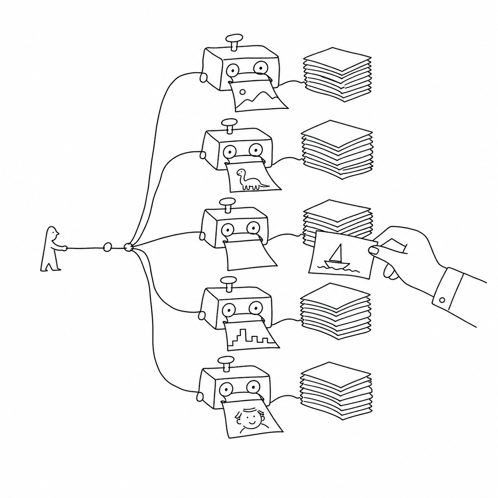

# vexy-dexypy

`vexy-dexypy` turns a web page into slide decks. It takes one URL or local HTML
file, works out where the slides inside the page should break, and renders the
page to PDF through several engines in parallel. Each engine writes its own
folder of single-page PDFs. You compare the folders and build your final deck
from the best version of each slide.



No two engines paginate a page the same way. A Webflow hero often looks best
through Chromium, while a documentation page often looks best through a CSS
paged-media engine. `vexy-dexypy` runs the engines side by side and leaves the
choice to you.

## What goes in, what comes out

Input
:   An `http://` or `https://` URL, or a path to a local `.html` file.

Output
:   A folder per page under `out/`, with one sub-folder per rendering strategy
    and a `_meta/` folder that records the slide plan and the run summary.

For `vexy-dexypy build https://www.vexy.art/lines/` the result looks like this
(the folder name is a slug derived from the URL):

```text
out/www-vexy-art-lines/
  raw/            index.html                 # the fetched page
  normalized/     normalized.html            # slide-shaped sections
  playwright/     01-slide.pdf  02-slide.pdf  …  index.html
  reveal/         01-slide.pdf  …  index.html
  vivliostyle/    01-slide.pdf  …  index.html
  _meta/          page.json  slideplan.json  run-summary.json
```

A strategy that fails becomes a warning in the summary table. The run still
writes the decks that worked.

## The six stages

1. **Read**: fetch the page (or copy the local file).
2. **Analyze**: recognize the page builder (Webflow, MkDocs Material, and
   others) and plan slide breaks at the target stage size.
3. **Normalize**: restructure the DOM into slide-shaped `<section>` elements,
   in the browser, with the bundled `vexy-dexyjs` preprocessor.
4. **Prepare**: write the paged-media CSS, reveal.js, impress.js or Marp
   wrapping that each engine expects.
5. **Render**: export a combined PDF through every selected engine.
6. **Write**: split each PDF into numbered single-page files, optionally
   convert them to SVG, and write an HTML preview.

[Architecture](architecture.md) follows one page through every stage.

## Where to go next

- [Installation](installation.md): Python, Chromium and the optional engines.
- [Quick start](quickstart.md): your first build, step by step.
- [Command line](cli.md): every command and flag.
- [Configuration](configuration.md): `vexy-dexypy.toml` keys and precedence.
- [Engines](engines.md): what each strategy does and what it needs.
- [Extending](extending.md): add readers, importers or exporters as plugins.
- [Troubleshooting](troubleshooting.md): common failures and fixes.
- [Contributing](contributing.md): development setup, tests and releases.

## Licence

See the
[`LICENSE`](https://github.com/vexyart/vexy-dexypy/blob/main/LICENSE) file in
the repository. Some engines `vexy-dexypy` can call have their own licences: Vivliostyle is AGPL and Prince is proprietary.
`vexy-dexypy` runs them as separate programs and does not link them.
